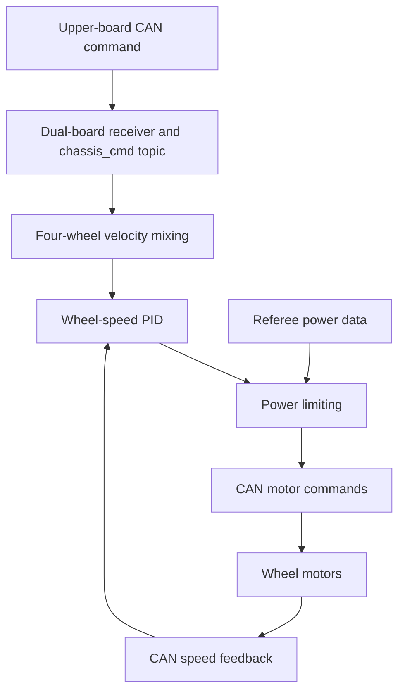
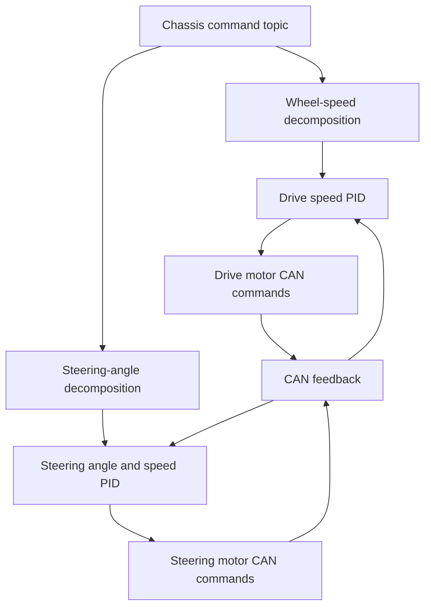
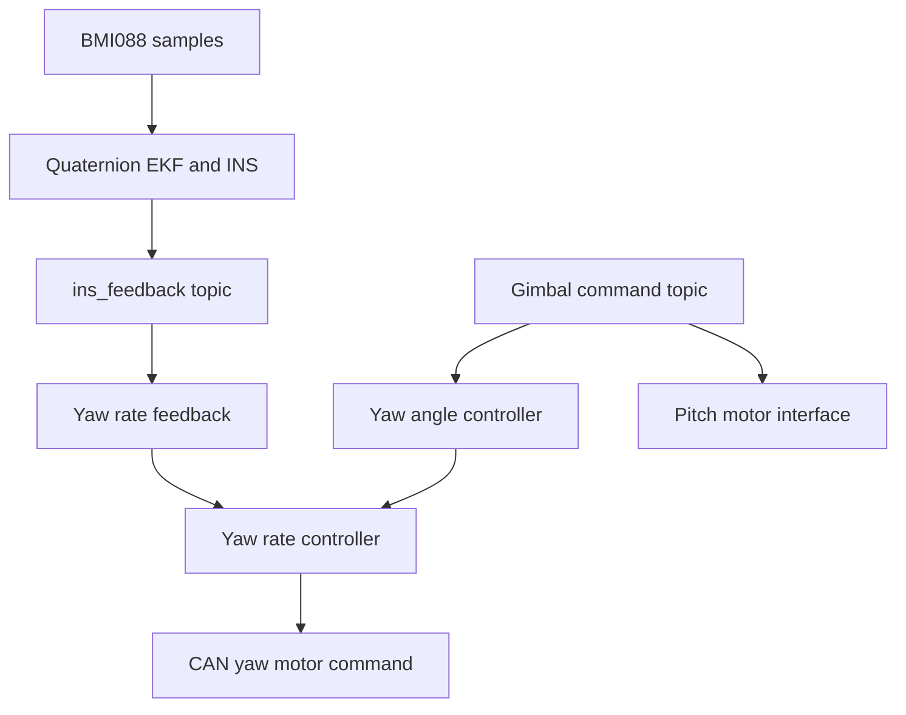

# Control and Communication Architecture

The diagrams below follow the source. The startup table in [hardware.md](hardware.md) identifies which tasks are created in each supplied snapshot.

## Mecanum chassis

Source: `Application/chassis.c`, `Application/chassis_power_control.c`, and `modules/Dual_board/Dual_board.c`.

## Swerve drive

Source: `Applications/chassis.c` and `Applications/helm.c`. The steering code folds target angles and the drive code changes wheel direction for corresponding orientations.

## Gimbal source path

Source: `Application/ins_task.c`, `Application/gimbal.c`, and `Bsp/DMPower.c`. The gimbal task's creation is commented out in the supplied snapshot. This diagram describes the available control path, not an observed closed-loop hardware run.
